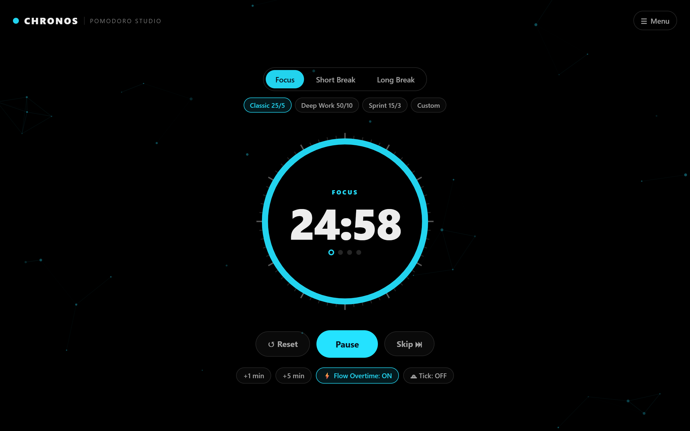
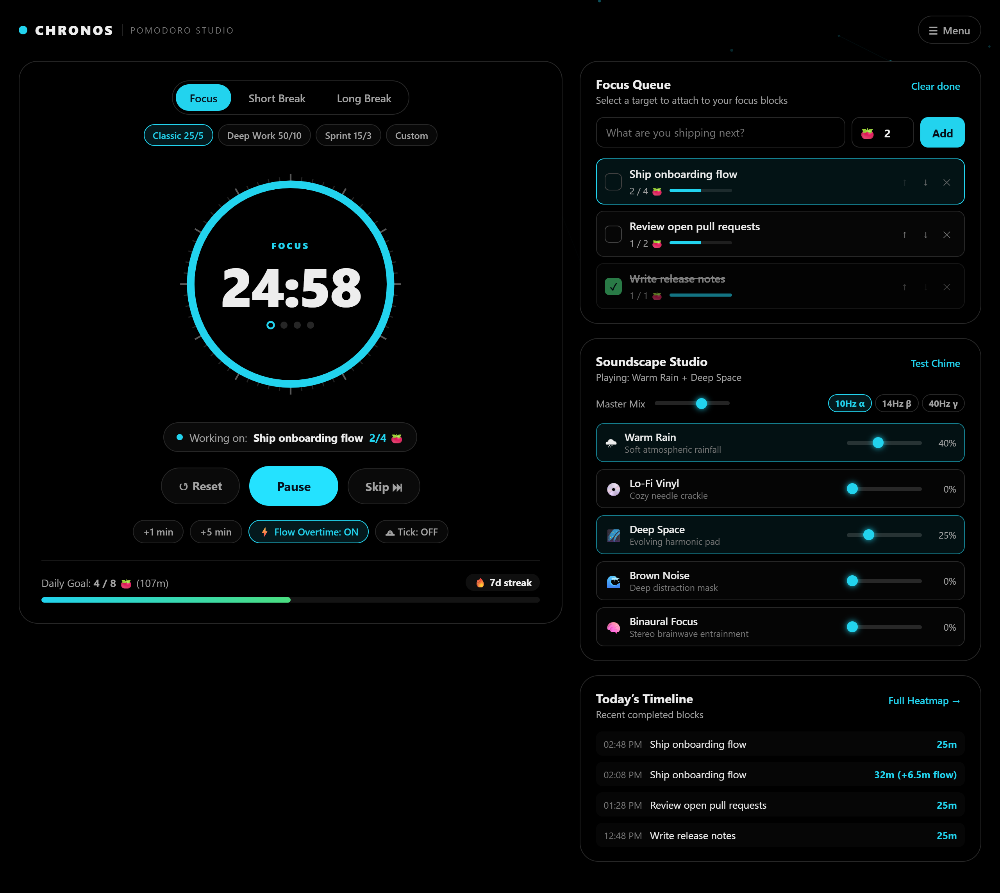
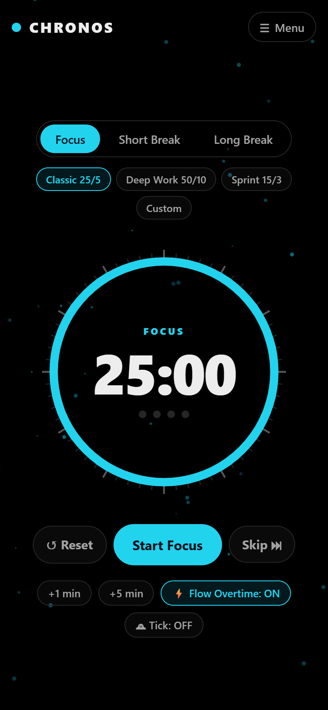
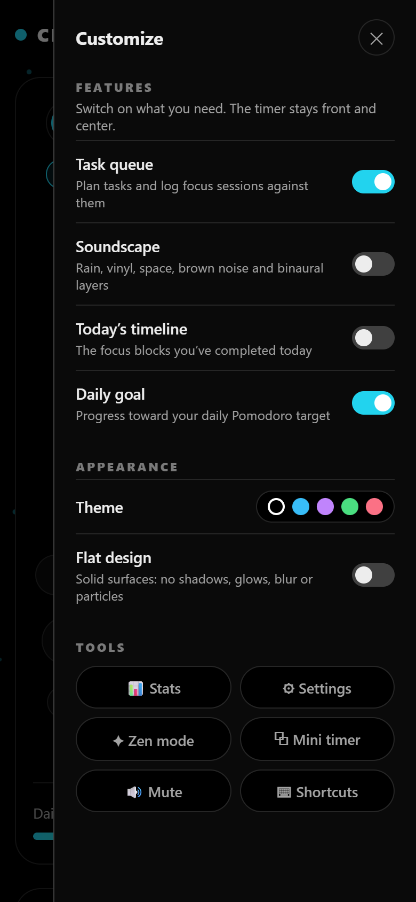

# CHRONOS — Pomodoro Focus Studio

A distraction-free Pomodoro timer for the browser. It opens to nothing but the timer; task tracking, ambient soundscapes, stats and more are there when you switch them on.

Built with TypeScript and Vite, with no framework and no runtime dependencies. All sound is synthesized in the browser, and all data stays on your device.

**Try it live: <https://amnag090.github.io/pomodoro_ts/>**



## Features

- **Zen-first timer.** Opens to a single, centered timer. Focus, short break and long break cycles, with Classic 25/5, Deep Work 50/10, Sprint 15/3 or custom presets.
- **Features you switch on from the side.** The **☰ Menu** drawer has switches for:
  - **Task queue**: plan tasks, estimate Pomodoros and log focus sessions against the active task.
  - **Soundscape**: mix rain, lo-fi vinyl, deep space, brown noise and binaural beats (10/14/40 Hz).
  - **Today's timeline**: the focus blocks you've completed today.
  - **Daily goal**: progress toward a daily Pomodoro target, with streaks.

  Everything starts off, and your choices are remembered.
- **Flow Overtime.** When a focus session hits 00:00, the timer keeps counting up (`+MM:SS`) instead of cutting you off mid-thought. Press **Finish & Break** when you're ready. The extra time is logged.
- **Tick sound.** An optional tick-tock each second during focus sessions.
- **Stats.** A 12-week focus heatmap, current and best streaks, all-time totals and your peak focus hours.
- **Themes.** AMOLED Black (the default: true black that keeps OLED pixels off), Cyber Neon, Midnight Lo-Fi, Matcha Zen and Solar Sunset. An optional **Flat design** mode removes shadows, glows, blur and particles on any theme.
- **Mini timer.** A floating picture-in-picture timer that stays on top of other windows.
- **Phone friendly.** The layout fits phone screens down to 320px wide.
- **Local-first.** No account and no server. Data is saved in the browser, with JSON export and import from the Stats window.

## Screenshots

With every feature switched on: the task queue, soundscape mixer, today's timeline and daily goal.



On a phone: the default view, and the Menu drawer where features are switched on.

<p align="center">
  
  &nbsp;&nbsp;
  
</p>

## Getting started

Requires **Node.js 22.12 or newer** (Node 24 recommended).

```bash
npm install
npm run dev
```

Then open <http://localhost:5173>.

| Command | What it does |
| --- | --- |
| `npm run dev` | Start the dev server with hot reload |
| `npm run build` | Type-check and build for production into `dist/` |
| `npm run preview` | Serve the production build locally |
| `npm test` | Run the unit tests once (Vitest) |
| `npm run test:watch` | Run the tests in watch mode |
| `npm run typecheck` | Type-check without emitting files |

## Deployment

The app is a static site, deployed to GitHub Pages by [`.github/workflows/deploy.yml`](.github/workflows/deploy.yml). Every push to `main` runs the tests, builds the site and publishes it. A failing test stops the deploy, so the live site keeps the last good version.

To set it up on your own fork:

1. In the repo, go to **Settings → Pages**, and under **Build and deployment** set **Source** to **GitHub Actions**.
2. Push to `main`, or run the workflow manually from the **Actions** tab.

The site is published at `https://<your-username>.github.io/<repo-name>/`. Asset paths are relative (`base: './'` in [`vite.config.ts`](vite.config.ts)), so the build works from that subfolder, or from any other static host: just upload the `dist/` folder.

## Keyboard shortcuts

| Key | Action |
| --- | --- |
| `Space` | Start, pause, or finish Flow Overtime |
| `R` | Reset the current timer |
| `S` | Skip to the next phase |
| `1` / `2` / `3` | Switch to Focus / Short Break / Long Break |
| `M` | Mute or unmute all audio |
| `Z` | Toggle Zen mode (hides everything but the timer) |
| `P` | Toggle the mini timer |
| `?` | Show the shortcuts guide |
| `Esc` | Close the menu or a dialog, or exit Zen mode |

## Project structure

```text
src/
├── main.ts               Entry point: mounts the app into #app
├── types.ts              Shared types (settings, tasks, sessions, UI preferences)
├── core/                 Framework-free logic, unit tested
│   ├── timer.ts          Pomodoro engine: phases, cycles, presets, Flow Overtime
│   ├── storage.ts        Load/save to localStorage and validate saved data
│   ├── tasks.ts          Task queue operations
│   ├── stats.ts          Streaks, 12-week heatmap and hourly totals
│   └── __tests__/        Vitest tests
├── audio/
│   └── soundEngine.ts    Web Audio synthesis: soundscapes, chimes, tick
├── ui/
│   ├── app.ts            Renders the page and wires up all interactions
│   ├── themes.ts         Theme definitions
│   ├── heatmap.ts        SVG heatmap and hourly chart
│   ├── particles.ts      Animated particle background
│   ├── favicon.ts        Live countdown in the tab title and icon
│   └── notifications.ts  In-app messages and desktop notifications
└── styles/
    └── main.css          All styles, themes and the flat design mode
```

## How it works

- **Accurate timing.** The engine measures real elapsed time on each update instead of counting interval ticks, so the timer stays correct even when the browser slows timers in a background tab. It takes an injectable clock, which makes it straightforward to test.
- **No audio files.** Soundscapes, chimes and the tick are all generated live with the Web Audio API.
- **Your data.** Everything is stored in `localStorage` under the key `chronos.pomodoro.v1`. Saved data is validated on load, so a corrupted or outdated entry falls back to safe defaults instead of breaking the app. Use **Stats → Export JSON Backup** to keep a copy or move it to another browser.

## Browser notes

- **Sound** starts after your first click or key press, because browsers block audio until you interact with the page.
- **Mini timer:** Chrome and Edge open a real always-on-top window (Document Picture-in-Picture). Other browsers show a floating mini timer inside the page instead.
- **Desktop notifications** are off by default. Turn them on in Settings, and allow them when the browser asks.
